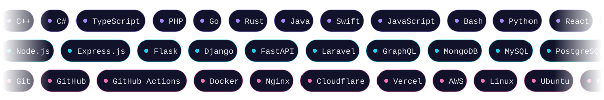

 

  

<table>
<tr>
<td width="290" align="center" valign="middle">

</td>
<td valign="middle" align="center">

</td>
</tr>
</table>

| Field | What I do |
| :-- | :-- |
| **Graphic Design** | Branding, UI visuals and creative assets |
| **Cyber Security** | Security testing, hardening and analysis |
| **DevOps** | CI/CD, containers, servers and automation |
| **Web Scraper** | Data extraction and automation tools |
| **Full Stack Developer** | End to end web applications and APIs |
| **More** | Always learning and building new things |

**Programming Languages**

**Frontend**

**Backend**

**Database**

**Cloud and DevOps**

**Systems and Security**

**Tools and Design**

 

 

 

  

