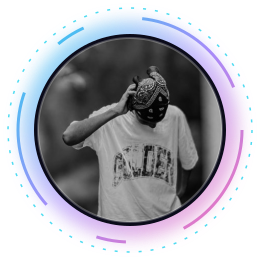
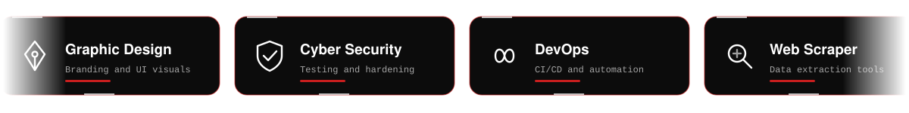

 

  

  

<table>
<tr>
<td width="290" align="center" valign="middle">

</td>
<td valign="middle" align="center">

</td>
</tr>
</table>

 

 

 

If my work helped you, you can support me with a coffee.

  

  

